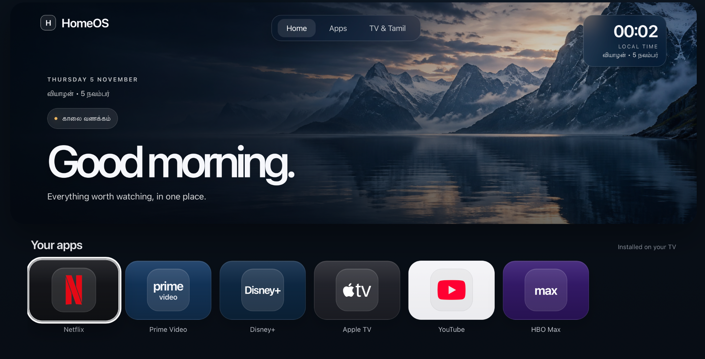

# HomeOS

**A personal home interface for Hisense VIDAA televisions.**

HomeOS is a lightweight, browser-based dashboard built as an alternative starting point for navigating content on a smart TV.

The project began as an experiment in building a more personal television interface — one that prioritises simplicity, remote-control navigation, and direct access to frequently used services.

It runs as a static web application inside the VIDAA browser, without requiring a backend or modifying the television's firmware.

---

## Overview

| | |
| :--- | :--- |
| **Platform** | Hisense VIDAA (built-in browser) |
| **Frontend** | HTML, CSS, Vanilla JavaScript |
| **Navigation** | Directional remote / keyboard |
| **Persistence** | Browser Local Storage |
| **Deployment** | Static hosting / GitHub Pages |
| **Project** | Independent, experimental |

## Features

**01 / Remote-first navigation**

Directional focus navigation across interactive elements, with support for selection and returning from dialogs using standard remote-control inputs.

**02 / Organised shortcuts**

Separate sections for TV applications, music, web services, Tamil and Indian entertainment, and personal bookmarks.

**03 / Personal bookmarks**

Custom HTTPS destinations can be configured directly in the interface and saved locally in the browser.

**04 / Localisation**

English and Tamil date information and time-aware greetings are integrated into the home screen.

**05 / Lightweight implementation**

A static frontend without a build process, server-side application, or user-account system.

## Navigation

| Input | Behaviour |
| :--- | :--- |
| Left / Right | Move between interactive elements |
| Up / Down | Navigate vertically |
| OK / Enter | Select the focused element |
| Back / Escape | Close an open dialog |
| Section shortcuts | Jump to another dashboard section |

Input behaviour may vary with the VIDAA browser and remote-control model.

## Getting started

### Run locally

1. Download or clone this repository.
2. Open `index.html` in a browser.
3. Use the keyboard's arrow keys and Enter to navigate.

### Deploy using GitHub Pages

1. Open the repository's **Settings → Pages**.
2. Under **Build and deployment**, select **Deploy from a branch**.
3. Select `main` and `/(root)`.
4. Save the configuration.
5. Once GitHub Pages is published, open the generated URL in your TV's VIDAA browser.

No dependency installation or build command is required.

## Technical notes

HomeOS uses a single-page, static architecture.

- Interface styling and interaction logic are implemented directly in `index.html`.
- Directional navigation uses the positions of interactive elements to determine the next focus target.
- Bookmark destinations are validated as HTTPS URLs and stored using `localStorage`.
- Image and icon assets are included alongside the application.
- The time and date display uses the device's local clock.

## Scope and limitations

This repository contains the browser-based dashboard implementation.

Native application tiles are visual shortcuts. They do not launch installed VIDAA applications directly; users must open those applications through the television's native home interface.

External websites may have their own browser compatibility or playback restrictions. The dashboard itself is designed without advertising, but it does not block advertisements on third-party services.

Bookmarks are stored locally and may be lost when the browser's data is cleared.

This is an independent personal project and is not affiliated with Hisense, VIDAA, or the third-party services represented in the interface.

---

**Status:** Personal project · Browser dashboard implementation
